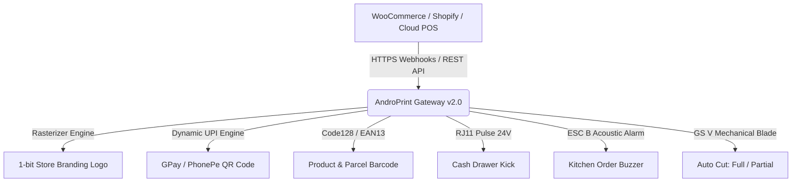

<div align="center">


# ANDROPRINT v2.0
### *Next-Gen Standalone ESC/POS & Cloud Print Gateway*
*(Termux-Less Standalone Android APK • Auto-SSL • 0% Emojis • Vector Icons)*

<p align="center">
  
</p>

[](https://github.com/msamods/androprint)
[](https://github.com/msamods/androprint)
[](https://github.com/msamods/androprint)
[](LICENSE)
[](https://github.com/msamods/androprint/wiki)

[-3DDC84?style=for-the-badge&logo=android&logoColor=white)](https://github.com/msamods/androprint/releases/download/v2.0.0/AndroPrint-v2.0.0-release.apk)
[-0078D6?style=for-the-badge&logo=windows&logoColor=white)](https://github.com/msamods/androprint/releases/download/v2.0.0/AndroPrint-Windows.exe)
[](https://github.com/msamods/androprint/releases/tag/v2.0.0)

<br/>

> **Developed By : [MSA MODS](https://github.com/msamods) × WhatYouWantKerala**  
> *Transform any Android Phone, Windows Desktop, or Raspberry Pi into a high-speed, secure Cloud Thermal Print Server with zero drivers.*

<br/>

<p align="center">
  <a href="#features"></a>&nbsp;
  <a href="#sdk"></a>&nbsp;
  <a href="#webhooks"></a>&nbsp;
  <a href="#autocut"></a>&nbsp;
  <a href="#android-apk"></a>&nbsp;
  <a href="#windows-exe"></a>&nbsp;
  <a href="#api-docs"></a>&nbsp;
  <a href="https://github.com/msamods/androprint/wiki"></a>
</p>

---

</div>

<br/>

## 🌟 Highlights at a Glance

<table>
  <tr>
    <td width="50%" align="center">
      
      <h3>📱 Mobile-First Architecture</h3>
      <p>Runs on any cheap Android device with background Wakelock. No PCs, Raspberry Pis, or dedicated spoolers required.</p>
    </td>
    <td width="50%" align="center">
      
      <h3>☁️ Cloud Connected Webhooks</h3>
      <p>Instant auto-printing for WooCommerce, Shopify, Foodomaa, Telegram bots, or custom POS via webhooks.</p>
    </td>
  </tr>
  <tr>
    <td width="50%" align="center">
      <h3>📲 UPI QR & Hardware Control</h3>
      <p>Native dynamic UPI payment QR codes (GPay/PhonePe), 1-bit receipt logos, buzzer alarms, and cash drawer kicks.</p>
    </td>
    <td width="50%" align="center">
      <h3>🌐 Any-Language UTF-8</h3>
      <p>Full support for Malayalam (മലയാളം), Hindi, Tamil, Arabic, Chinese, Cyrillic, and European scripts.</p>
    </td>
  </tr>
</table>

<br/>

---

<span id="features"></span>
## 🚀 Latest Features (v2.0)



### 1. 📲 Dynamic UPI & Payment QR Code Engine
* **Instant Scan-to-Pay**: Generates dynamic UPI payment QR codes (`upi://pay?pa=merchant@upi&pn=Store&am=450.00`) directly on the bottom of the bill.
* **Universal Compatibility**: Works out of the box with **Google Pay, PhonePe, Paytm, BHIM, Cred**, and international payment URLs.
* High-contrast raster QR ensures instantaneous scanning by phone cameras under low-light restaurant counters.

### 2. 🖼️ Receipt Store Logo Rasterizer
* Automatically converts PNG, JPG, or WebP logos into 1-bit monochrome thermal raster bitmaps using Floyd-Steinberg dithering.
* Supports persistent branding stored on the server via `POST /api/printer/logo` or per-ticket embedded logos in `POST /print`.

### 3. 💵 Cash Drawer Kick (RJ11/RJ12 Pin 2 / Pin 5)
* Sends standard high-current 24V solenoid pulse (`ESC p 0 25 250`) to instantly pop open the cash register drawer upon cash sale prints.
* Dedicated trigger endpoint: `POST /api/printer/drawer-kick`.

### 4. 🔔 Kitchen Buzzer / Order Alert Beep
* Emits acoustic alerts (`ESC B 2 2`) on thermal printers in noisy restaurant kitchens whenever a new Kitchen Order Ticket (KOT) arrives.
* Dedicated alert endpoint: `POST /api/printer/buzzer`.

<span id="autocut"></span>
### 5. ✂️ Smart Auto Cut (Full & Partial Cut with Offset Protection)
* **Full Cut (`mode: "full"`)**: Cuts cleanly across the paper roll for checkout counters.
* **Partial Cut (`mode: "partial"`)**: Cuts ~95% across the paper, leaving a small center tab so orders don't blow away or fall on the kitchen floor.
* **Printhead-to-Cutter Offset Protection**: Automatically injects configurable line feeds (`feedLines: 3`) before firing the blade, preventing bills and QR codes from being chopped in half.
* Dedicated manual cut endpoint: `POST /api/printer/cut`.

<span id="webhooks"></span>
### 6. 🛒 Automated E-Commerce & POS Webhooks
* Built-in webhook receivers for instant physical ticket printing whenever an online order is placed:
  - 🛍️ **WooCommerce**: `/webhook/woocommerce` (Order Created / Order Updated)
  - 🏬 **Shopify**: `/webhook/shopify` (`orders/create` topics)
  - 🤖 **Telegram**: `/webhook/telegram` (Direct bot order notifications)
  - ⚡ **Generic POS / ERP**: `/webhook/print`
* Includes an interactive Webhook Testing Dashboard with an order simulator: [`webhook.html`](public/webhook.html).

### 7. 🔍 Auto Network Printer Discovery
* **LAN Subnet Radar**: Scans your local `/24` subnet (e.g. `192.168.1.1` to `192.168.1.254`) on Port 9100 in 3-4 seconds with high-concurrency non-blocking sockets.
* **Model Identification**: Transmits `GS I 67` hardware probes to automatically read manufacturer model numbers (e.g., Epson, Xprinter, Rongta).
* **1-Click Setup**: Auto-detects subnet and lets you pre-fill and save printers with a single click in [`printer.html`](public/printer.html) or via `GET /api/printers/discover`.

### 8. 🍳 Multi-Printer Smart Routing & Role Split
* **Automatic KOT / BOT / Bill Split**: Dispatch an entire restaurant order to `POST /api/print/route`:
  - 🍗 **Kitchen Items** (`category: "kitchen"`) -> Routes to `KITCHEN` printer as formatted KOT with large table number, item notes, buzzer beep, and partial cut.
  - 🍹 **Beverages** (`category: "bar"`) -> Routes to `BAR` printer as BOT ticket.
  - 🧾 **Customer Bill** -> Routes to `CASHIER` printer with full itemization, taxes, grand total, dynamic UPI payment QR, drawer kick, and auto-cut.
* **Intelligent Failover**: If the `KITCHEN` or `BAR` printer goes offline, tickets automatically reroute to the `CASHIER` printer with a high-visibility `[FAILOVER ROUTED]` header so no order is ever missed!

### 9. 🧾 Visual Receipt Template Designer (WYSIWYG)
* **Interactive Drag-and-Drop Builder**: Design custom receipts directly in [`designer.html`](public/designer.html).
* **Live 58mm / 80mm Roll Preview**: Features realistic thermal paper roll rendering with jagged serrated bottom tear edge and monospace font simulation.
* **Rich Component Library**: Headers, logos, key-value meta grids, tabular line items, totals blocks, dynamic UPI QR codes, Code128 barcodes, and custom dividers.
* **API Template Engine**: Save templates to `templates.json` and print them dynamically via `POST /api/template/render-and-print`.

### 10. 📄 HTML & PDF-to-Receipt Auto-Converters
* **HTML to Receipt (`POST /api/print/html`)**: Automatically translates HTML headings, `<table>` grids, columns, bullet points, and styling into perfectly aligned ESC/POS thermal text.
* **PDF to Receipt (`POST /api/print/pdf`)**: Accepts PDF documents or base64 streams, parses layouts and columns via `pdf-parse`, wraps lines to receipt width, and prints cleanly with auto-cut.

### 11. ⚡ MQTT Cloud Pub/Sub Instant Printing (Zero Tunnels)
* **No Open Ports / No Tunnels Required**: AndroPrint maintains a persistent outbound connection to any MQTT broker (`mqtt://broker.hivemq.com` or custom).
* **Sub-100ms Global Printing**: Any remote web app, cloud store, or mobile phone can publish a JSON payload to `androprint/{SERVER_ID}/print` to print tickets instantaneously across firewalls, NAT, and 4G/5G mobile carriers.
* **Status Heartbeat**: Automatically broadcasts live printer status and availability to `androprint/{SERVER_ID}/status`.

<br/>

---

## 🏗️ Interactive Web Interfaces

All administrative dashboards are accessible directly from your browser:

| Interface | Description | Live Route |
| :--- | :--- | :--- |
| **🖨️ Operations Terminal** | Live printer cards, quick print, server telemetry, and status counters | [`dashboard.html`](public/dashboard.html) |
| **🧾 Template Designer** | Visual WYSIWYG receipt layout builder with 58mm/80mm live paper roll preview | [`designer.html`](public/designer.html) |
| **🔍 Network Discovery** | Subnet scanner radar to discover network thermal printers on Port 9100 | [`printer.html`](public/printer.html) |
| **🌐 Webhook Simulator** | Live webhook endpoint copier and interactive order dispatcher | [`webhook.html`](public/webhook.html) |
| **📶 Web Direct Print** | Browser-to-Printer Bluetooth & USB OTG direct controller | [`webprint.html`](public/webprint.html) |
| **⚙️ Hardware Config** | Network printer management, test print dispatch, paper sizes, roles | [`printer.html`](public/printer.html) |
| **👥 POS Clients** | API keys, secret tokens, granular client permission toggles | [`clients.html`](public/clients.html) |
| **☁️ Cloud Connect** | Cloudflare Tunnel registration + MQTT Cloud Pub/Sub gateway | [`cloud.html`](public/cloud.html) |
| **📋 Queue Telemetry** | Historical logs, success/failure analytics, and job inspector | [`jobs.html`](public/jobs.html) |

<br/>

<br/>

---

## 🚀 Quick Start Guide

### 1️⃣ Option A: Universal One-Click Android Installer (Android 8 - 16)
Transform any Android phone into an autonomous print hub in 60 seconds with our animated installer:

```bash
# One-Click Install in Termux:
curl -sSL https://raw.githubusercontent.com/msamods/androprint/main/install.sh | bash

# Or clone and run:
git clone https://github.com/msamods/androprint.git
cd androprint
bash install.sh
```

#### ✨ What the One-Click Installer Sets Up Automatically:
* 📲 **All Phone Support**: 100% compatible with Android 8 (Oreo) up to Android 16 (Baklava) across `aarch64`, `arm`, and `x86_64`.
* 🔋 **Android CPU Wakelock**: Prevents Doze mode battery sleep so printing works 24/7.
* 🔒 **Local SSL HTTPS Active**: Auto-generates 10-year SSL certs with SAN for `https://localhost:3000` and local Wi-Fi IPs.
* 🖨️ **Single-Phone Standalone Hub**: Connect USB OTG, Bluetooth, and Wi-Fi LAN thermal printers directly to one phone without cloud or PC.
* ⚙️ **Dynamic Port Changer**: Change port live from the GUI or via `androprint port <PORT>`.
* 🛠️ **Termux Terminal CLI (`androprint`)**:
  ```bash
  androprint start      # Start server in background with Wakelock
  androprint stop       # Stop background server
  androprint restart    # 1-second clean restart
  androprint status     # Live PID, port & memory status
  androprint logs       # Stream real-time logs
  androprint repair     # 1-Click self-healing bug fix
  androprint port 8080  # Change port dynamically
  androprint open       # Open Web Dashboard in browser
  ```
* 📲 **One-Tap Termux:Widget Shortcuts**:
  Adds 5 quick desktop widgets to `~/.shortcuts/` (`AndroPrint-Start.sh`, `AndroPrint-Stop.sh`, `AndroPrint-Restart.sh`, `AndroPrint-Repair.sh`, `AndroPrint-OpenUI.sh`).
* 🔄 **Termux:Boot Auto-Start**: Boots automatically whenever your phone restarts.
* 🛡️ **1-Click Auto-Repair Engine**: Identifies issues (memory, wakelock, stuck jobs, certs) and fixes them automatically.

### 2️⃣ Option B: Linux / Windows / macOS (Node.js)
```bash
git clone https://github.com/msamods/androprint.git
cd androprint
npm install
npm run ssl    # Generate 10-year SSL certificates with SAN
npm start      # Starts on https://localhost:3000
```

<span id="windows-exe"></span>
### 3️⃣ Option C: Windows Standalone (`.exe`)
No Node.js or npm needed on client PCs! Download or build the standalone Windows binary:
```bash
npm run build:exe
```
Or download the pre-packaged executable directly:  
👉 **[Download AndroPrint-Windows.exe (v2.0.0)](https://github.com/msamods/androprint/releases/download/v2.0.0/AndroPrint-Windows.exe)**

---

---

<span id="android-apk"></span>
## 📱 Termux-less Standalone Android `.apk` (Zero Termux Required)

For environments where customers want a pure native Android install experience without touching a terminal:

### 🌟 1-Click Android App Architecture
* **Direct APK Install**: Just download and tap **[`AndroPrint-v2.0.0-release.apk`](https://github.com/msamods/androprint/releases/download/v2.0.0/AndroPrint-v2.0.0-release.apk)**.
* **Embedded Daemon & Service**: Runs via Android's native `PrintServerService` as a Foreground Service with an ongoing notification.
* **Doze Mode Immunity**: Uses native `PARTIAL_WAKE_LOCK` to keep CPU active for continuous print listening even when the phone screen is off or locked.
* **Auto-SSL Certificate Handshake**: Local 10-year SSL certs are pre-trusted inside the native WebView, ensuring zero warning popups for customers.
* **Built-in LAN IP Detector**: Automatically resolves phone's Wi-Fi IP and displays clickable management links.
* **Building from Source**: The full Gradle project is located in [`android-app/`](android-app/):
  ```bash
  cd android-app
  ./gradlew assembleRelease
  ```

---

## 🔒 Auto-SSL & Encrypted Local Communication

* **Localhost & LAN HTTPS**: Auto-generates high-security X.509 2048-bit RSA certificates on boot with full Subject Alternative Names (SAN) for `localhost`, `127.0.0.1`, and local Wi-Fi / Hotspot IP addresses.
* **10-Year Validity**: Never worry about certificate expirations on offline retail counters.
* **Browser Trust**: Inside the native APK WebView, SSL is automatically approved, and on desktop browsers, certificates can be installed into the Windows/Android root store with one click.
* **Manual Certificate Generation**:
  ```bash
  npm run ssl
  ```

---

## 📱 Strict Mobile Responsive & "No Zooming Allowed" Engine

Every interface in [`public/`](public/) is designed for mobile POS touchscreens, waiter tablets, and phones:
* **Strict Viewport Enforcement**:
  ```html
  <meta name="viewport" content="width=device-width, initial-scale=1.0, maximum-scale=1.0, minimum-scale=1.0, user-scalable=no, shrink-to-fit=no, viewport-fit=cover">
  ```
* **Gesture & Touch Lock**: Disables accidental double-tap zoom, rubber-band pull, and multi-touch pinch zoom via `touch-action: pan-y; -webkit-text-size-adjust: 100%;` and `gesturestart` cancellation.
* **16px Input Standard**: Prevents iOS Safari and Android Chrome from triggering auto-zoom when tapping text fields.
* **Glassmorphic Cyber Aesthetics**: Glowing status pills, animated radial health gauges, and dark cyber-neon palettes.

---

## 🖨️ Single-Phone Local Connected Devices Hub

Transform a single Android phone into a master print server for all your retail devices:
* 🔌 **USB OTG Printers**: Direct kernel communication via `/dev/usb/lp*`, `/dev/bus/usb/*`, and USB-Serial adapters (`CH340`, `PL2303`, `FTDI`).
* 📡 **Bluetooth Thermal Printers**: Real-time scanning and pairing of portable Bluetooth ESC/POS receipt printers.
* 📶 **Wi-Fi LAN Printers**: Fast subnet radar probing ESC/POS Port 9100 across the local network.
* 📲 **Hotspot Connected POS Terminals**: Automatically inspects the kernel ARP table (`/proc/net/arp`) to identify client devices connected to the phone's Wi-Fi hotspot.
* 🧪 **1-Click Test Prints**: Send immediate test receipts to any discovered device directly from the scanner list.

---

## ⚙️ Dynamic Port Changer & 🛡️ 1-Click Auto-Repair

* **Hot Port Switching**: Change ports (e.g. `3000` ➔ `8080`, `8443`, `9000`) on the fly through the web UI modal or via `androprint port <PORT>`. The server rebinds without crashing and automatically redirects your browser.
* **Diagnostic Health Score (`0% - 100%`)**: Live detection of RAM pressure, storage write capabilities, CPU wakelock status, and database integrity.
* **Self-Healing Bug Fixer**:
  ```bash
  bash repair.sh
  # or
  androprint repair
  ```
  Automatically sanitizes corrupted JSON databases (`jobs.json`, `printer.json`, `clients.json`), flushes stuck print jobs, clears zombie network sockets, and locks CPU wakelock.

---

<span id="api-docs"></span>
## 🔌 REST API Quick Reference

> 📖 **Full Interactive API Wiki & Payload Schema**: [**Read the Live GitHub Wiki →**](https://github.com/msamods/androprint/wiki)

### All-in-One Print (`POST /print`)

```bash
curl -X POST http://localhost:3000/print \
  -H "Content-Type: application/json" \
  -H "x-client-id: pos_register_01" \
  -H "x-print-key: 9842" \
  -d '{
    "printerId": "printer_counter_1",
    "text": "      MY RESTAURANT\n--------------------------------\nToken #42 - Table 4\nChicken Biryani x 2    ₹360.00\nLime Juice x 1          ₹40.00\n--------------------------------\nTOTAL:                 ₹400.00\n",
    "align": "left",
    "bold": false,
    "drawerKick": true,
    "buzzer": true,
    "cut": true,
    "cutMode": "partial",
    "feedLines": 3,
    "qr": {
      "upi": {
        "pa": "merchant@okaxis",
        "pn": "My Restaurant",
        "am": "400.00",
        "cu": "INR",
        "tn": "Order #42"
      }
    },
    "barcode": {
      "data": "ORD-2026-0042",
      "type": "CODE128"
    }
  }'
```

### Dedicated Hardware Control Endpoints

| Endpoint | Method | Description |
|---|---|---|
| `/api/printer/cut` | `POST` | Fire paper cutter (`mode: "full"` or `"partial"`, `feed: 3`) |
| `/api/printer/drawer-kick` | `POST` | Pulse RJ11/RJ12 24V solenoid to open cash drawer |
| `/api/printer/buzzer` | `POST` | Trigger acoustic alert beep (`count: 2`) |
| `/api/printer/qr` | `POST` | Direct dynamic UPI / payment QR ticket |
| `/api/printer/barcode` | `POST` | Direct Code128 / EAN13 barcode ticket |
| `/api/printer/logo` | `POST` | Upload and rasterize store branding logo |
| `/api/printer/test` | `POST` | Send diagnostic hardware test print |

<br/>

---

<span id="sdk"></span>
## 📦 Official Developer Client SDK

Integrate thermal printing directly into your own Web App, Point-of-Sale (POS), Python backend, or Flutter app using the official [**AndroPrint SDK**](sdk/):

### JavaScript / Node.js
```javascript
const AndroPrint = require('./sdk/androprint.js');

// Connect via Pair Code (Zero Tunnels / MQTT)
const printer = new AndroPrint({
  mode: 'mqtt',
  pairCode: 'srv-0f6fecb2' // Displayed on AndroPrint APK / EXE screen
});

// Print instant receipt from any cloud server!
await printer.print({
  text: "ANDROPRINT COFFEE\nOrder #101\nTotal: Rs. 150.00\n",
  qr: { upi: { pa: "merchant@okaxis", am: "150.00", pn: "Cafe" } },
  drawerKick: true,
  cut: true
});

// Multi-Printer Smart Routing (Kitchen KOT + Bar BOT + Cashier Bill)
await printer.routeOrder({
  orderId: "ORD-501",
  table: "Table 12",
  items: [
    { name: "Butter Chicken", qty: 1, price: 280, category: "kitchen" },
    { name: "Fresh Mojito", qty: 2, price: 90, category: "bar" }
  ],
  total: 460
});
```

👉 See the complete [**Developer SDK Integration Guide & Multi-Language Examples**](sdk/README.md) for Python, Flutter, Dart, and PHP.

<br/>

---

## 🌐 Any-Language Multilingual Receipts

AndroPrint supports raw UTF-8 multi-byte encoding for printing receipts in any international or regional script:

<details>
<summary><b>Click to view Malayalam (മലയാളം) Receipt Payload</b></summary>

```json
{
  "printerId": "Cashier1",
  "text": "*** ആന്ത്രോപ്രിന്റ് ക്ലൗഡ് ***\nമേശ നമ്പർ: 04    തീയതി: 2026-10-20\n--------------------------------\n1x ചിക്കൻ ബിരിയാണി        ₹180.00\n1x മലബാർ പൊറോട്ട (3 എണ്ണം)  ₹45.00\n1x ഫ്രഷ് ലൈം സോഡ          ₹40.00\n--------------------------------\nആകെ തുക:                   ₹265.00\n--------------------------------\n       നന്ദി! വീണ്ടും വരിക!\n"
}
```
</details>

<details>
<summary><b>Click to view Hindi (हिन्दी) Receipt Payload</b></summary>

```json
{
  "printerId": "Cashier1",
  "text": "*** एंड्रोप्रिंट क्लाउड ***\nमेज संख्या: 04    दिनांक: 2026-10-20\n--------------------------------\n1x पनीर टिक्का मसाला      ₹220.00\n2x तंदूरी रोटी              ₹40.00\n1x मीठी लस्सी               ₹50.00\n--------------------------------\nकुल योग:                  ₹310.00\n--------------------------------\n    धन्यवाद! फिर पधारें!\n"
}
```
</details>

<details>
<summary><b>Click to view Arabic (العربية) Receipt Payload</b></summary>

```json
{
  "printerId": "Cashier1",
  "text": "*** أندروبرينت كلاود ***\nطاولة رقم: ٠٤\n--------------------------------\n١x شاورما دجاج             ٣٥.٠٠ ر.س\n١x بطاطس مقلية            ١٥.٠٠ ر.س\n--------------------------------\nالمجموع الكلي:            ٥٠.٠٠ ر.س\n--------------------------------\n        شكراً لزيارتكم!\n"
}
```
</details>

<br/>

---

<div align="center">

## ⚖️ License, Copyright & Strict Anti-Piracy Policy

Copyright (c) 2026 **[MSA MODS](https://github.com/msamods)** × **WhatYouWantKerala**. All Rights Reserved.  
Released under the **[MSA MODS Source-Available Strict License](LICENSE.md)**.

> ### 🚨 STRICT DMCA COPYRIGHT ENFORCEMENT NOTICE
> - **No Unauthorized Duplicate Forks:** Creating public forks, mirrors, or clone repositories without express prior written consent from MSA MODS is strictly prohibited.
> - **Mandatory Attribution:** If authorized, full original credits to **MSA MODS x WhatYouWantKerala** must remain prominently visible in all documentation and UI interfaces.
> - **No Rebranding or Resale:** You may not modify branding, remove watermarks, or distribute/sell AndroPrint APKs on Google Play Store, third-party APK platforms, or Telegram.
> - **Zero Tolerance for Infringement:** Any unauthorized clone or fork will face an **immediate DMCA Copyright Strike** and legal takedown on GitHub and hosting providers.

For permissions or enterprise white-label licensing: **`msamods.org@gmail.com`**

<p align="center">
  
</p>

</div>
