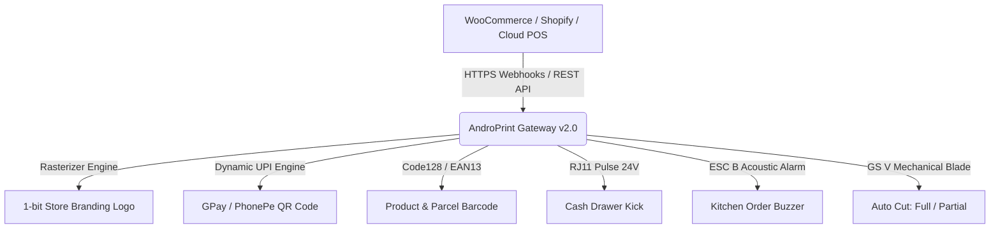

<div align="center">

# 🖨️ ANDROPRINT v2.0
### *Next-Gen Cloud & LAN Thermal ESC/POS Print Gateway*

<p align="center">
  
</p>

[](https://github.com/msamods/androprint)
[](https://github.com/msamods/androprint)
[](https://github.com/msamods/androprint)
[](LICENSE)
[](https://github.com/msamods/androprint/wiki)

[-3DDC84?style=for-the-badge&logo=android&logoColor=white)](https://github.com/msamods/androprint/releases/download/v2.0.0/AndroPrint-v2.0.0-release.apk)
[-0078D6?style=for-the-badge&logo=windows&logoColor=white)](https://github.com/msamods/androprint/releases/download/v2.0.0/AndroPrint-Windows.exe)
[](https://github.com/msamods/androprint/releases/tag/v2.0.0)

<br/>

> **Developed By : [MSA MODS](https://github.com/msamods) × WhatYouWantKerala**  
> *Transform any Android Phone, Windows Desktop, or Raspberry Pi into a high-speed, secure Cloud Thermal Print Server with zero drivers.*

<br/>

<p align="center">
  <a href="#features"></a>&nbsp;
  <a href="#webhooks"></a>&nbsp;
  <a href="#autocut"></a>&nbsp;
  <a href="#android-apk"></a>&nbsp;
  <a href="#windows-exe"></a>&nbsp;
  <a href="#api-docs"></a>&nbsp;
  <a href="https://github.com/msamods/androprint/wiki"></a>
</p>

---

</div>

<br/>

## 🌟 Highlights at a Glance

<table>
  <tr>
    <td width="50%" align="center">
      
      <h3>📱 Mobile-First Architecture</h3>
      <p>Runs on any cheap Android device with background Wakelock. No PCs, Raspberry Pis, or dedicated spoolers required.</p>
    </td>
    <td width="50%" align="center">
      
      <h3>☁️ Cloud Connected Webhooks</h3>
      <p>Instant auto-printing for WooCommerce, Shopify, Foodomaa, Telegram bots, or custom POS via webhooks.</p>
    </td>
  </tr>
  <tr>
    <td width="50%" align="center">
      <h3>📲 UPI QR & Hardware Control</h3>
      <p>Native dynamic UPI payment QR codes (GPay/PhonePe), 1-bit receipt logos, buzzer alarms, and cash drawer kicks.</p>
    </td>
    <td width="50%" align="center">
      <h3>🌐 Any-Language UTF-8</h3>
      <p>Full support for Malayalam (മലയാളം), Hindi, Tamil, Arabic, Chinese, Cyrillic, and European scripts.</p>
    </td>
  </tr>
</table>

<br/>

---

<span id="features"></span>
## 🚀 Latest Features (v2.0)



### 1. 📲 Dynamic UPI & Payment QR Code Engine
* **Instant Scan-to-Pay**: Generates dynamic UPI payment QR codes (`upi://pay?pa=merchant@upi&pn=Store&am=450.00`) directly on the bottom of the bill.
* **Universal Compatibility**: Works out of the box with **Google Pay, PhonePe, Paytm, BHIM, Cred**, and international payment URLs.
* High-contrast raster QR ensures instantaneous scanning by phone cameras under low-light restaurant counters.

### 2. 🖼️ Receipt Store Logo Rasterizer
* Automatically converts PNG, JPG, or WebP logos into 1-bit monochrome thermal raster bitmaps using Floyd-Steinberg dithering.
* Supports persistent branding stored on the server via `POST /api/printer/logo` or per-ticket embedded logos in `POST /print`.

### 3. 💵 Cash Drawer Kick (RJ11/RJ12 Pin 2 / Pin 5)
* Sends standard high-current 24V solenoid pulse (`ESC p 0 25 250`) to instantly pop open the cash register drawer upon cash sale prints.
* Dedicated trigger endpoint: `POST /api/printer/drawer-kick`.

### 4. 🔔 Kitchen Buzzer / Order Alert Beep
* Emits acoustic alerts (`ESC B 2 2`) on thermal printers in noisy restaurant kitchens whenever a new Kitchen Order Ticket (KOT) arrives.
* Dedicated alert endpoint: `POST /api/printer/buzzer`.

<span id="autocut"></span>
### 5. ✂️ Smart Auto Cut (Full & Partial Cut with Offset Protection)
* **Full Cut (`mode: "full"`)**: Cuts cleanly across the paper roll for checkout counters.
* **Partial Cut (`mode: "partial"`)**: Cuts ~95% across the paper, leaving a small center tab so orders don't blow away or fall on the kitchen floor.
* **Printhead-to-Cutter Offset Protection**: Automatically injects configurable line feeds (`feedLines: 3`) before firing the blade, preventing bills and QR codes from being chopped in half.
* Dedicated manual cut endpoint: `POST /api/printer/cut`.

<span id="webhooks"></span>
### 6. 🛒 Automated E-Commerce & POS Webhooks
* Built-in webhook receivers for instant physical ticket printing whenever an online order is placed:
  - 🛍️ **WooCommerce**: `/webhook/woocommerce` (Order Created / Order Updated)
  - 🏬 **Shopify**: `/webhook/shopify` (`orders/create` topics)
  - 🤖 **Telegram**: `/webhook/telegram` (Direct bot order notifications)
  - ⚡ **Generic POS / ERP**: `/webhook/print`
* Includes an interactive Webhook Testing Dashboard with an order simulator: [`webhook.html`](public/webhook.html).

<br/>

---

## 🏗️ Interactive Web Interfaces

All administrative dashboards are accessible directly from your browser:

| Interface | Description | Live Route |
| :--- | :--- | :--- |
| **🖨️ Operations Terminal** | Live printer cards, quick print, server telemetry, and status counters | [`dashboard.html`](public/dashboard.html) |
| **🌐 Webhook Simulator** | Live webhook endpoint copier and interactive order dispatcher | [`webhook.html`](public/webhook.html) |
| **📶 Web Direct Print** | Browser-to-Printer Bluetooth & USB OTG direct controller | [`webprint.html`](public/webprint.html) |
| **⚙️ Hardware Config** | Network printer management, test print dispatch, paper sizes | [`printer.html`](public/printer.html) |
| **👥 POS Clients** | API keys, secret tokens, granular client permission toggles | [`clients.html`](public/clients.html) |
| **☁️ Cloud Connect** | Cloudflare & Ngrok tunnel registration and cURL generators | [`cloud.html`](public/cloud.html) |
| **📋 Queue Telemetry** | Historical logs, success/failure analytics, and job inspector | [`jobs.html`](public/jobs.html) |

<br/>

---

## 🚀 Quick Start Guide

### 1️⃣ Option A: Android (Termux)
```bash
# Clone and setup (Installs packages, acquires Wakelock, and sets up Termux:Boot)
git clone https://github.com/msamods/androprint.git
cd androprint
bash setup.sh

# Run Server manually
node server.js
```
> 💡 **Auto-Start on Boot**: `setup.sh` automatically configures `~/.termux/boot/start-androprint.sh`. Whenever you restart your Android phone, AndroPrint boots up automatically in the background with Wakelock enabled!

### 2️⃣ Option B: Linux / Windows / macOS (Node.js)
```bash
git clone https://github.com/msamods/androprint.git
cd androprint
npm install
npm start
```

<span id="windows-exe"></span>
### 3️⃣ Option C: Windows Standalone (`.exe`)
No Node.js or npm needed on client PCs! Download or build the standalone Windows binary:
```bash
npm run build:exe
```
Or download the pre-packaged executable directly:  
👉 **[Download AndroPrint-Windows.exe (v2.0.0)](https://github.com/msamods/androprint/releases/download/v2.0.0/AndroPrint-Windows.exe)**

---

<span id="android-apk"></span>
## 📱 Native Android Print Agent (APK)

A complete native Android application project with **Background Foreground Service** and **WakeLock** is available in [`android-app/`](android-app/):

- **One-Touch Start / Stop**: Toggle the print engine with a single button.
- **Doze Mode Immunity**: Runs 24/7 without being stopped by Android battery managers.
- **Auto Wi-Fi IP Detection**: Instantly shows your phone's LAN IP address on the screen.
- 👉 **[Download AndroPrint-v2.0.0-release.apk](https://github.com/msamods/androprint/releases/download/v2.0.0/AndroPrint-v2.0.0-release.apk)**

<br/>

---

<span id="api-docs"></span>
## 🔌 REST API Quick Reference

> 📖 **Full Interactive API Wiki & Payload Schema**: [**Read the Live GitHub Wiki →**](https://github.com/msamods/androprint/wiki)

### All-in-One Print (`POST /print`)

```bash
curl -X POST http://localhost:3000/print \
  -H "Content-Type: application/json" \
  -H "x-client-id: pos_register_01" \
  -H "x-print-key: 9842" \
  -d '{
    "printerId": "printer_counter_1",
    "text": "      MY RESTAURANT\n--------------------------------\nToken #42 - Table 4\nChicken Biryani x 2    ₹360.00\nLime Juice x 1          ₹40.00\n--------------------------------\nTOTAL:                 ₹400.00\n",
    "align": "left",
    "bold": false,
    "drawerKick": true,
    "buzzer": true,
    "cut": true,
    "cutMode": "partial",
    "feedLines": 3,
    "qr": {
      "upi": {
        "pa": "merchant@okaxis",
        "pn": "My Restaurant",
        "am": "400.00",
        "cu": "INR",
        "tn": "Order #42"
      }
    },
    "barcode": {
      "data": "ORD-2026-0042",
      "type": "CODE128"
    }
  }'
```

### Dedicated Hardware Control Endpoints

| Endpoint | Method | Description |
|---|---|---|
| `/api/printer/cut` | `POST` | Fire paper cutter (`mode: "full"` or `"partial"`, `feed: 3`) |
| `/api/printer/drawer-kick` | `POST` | Pulse RJ11/RJ12 24V solenoid to open cash drawer |
| `/api/printer/buzzer` | `POST` | Trigger acoustic alert beep (`count: 2`) |
| `/api/printer/qr` | `POST` | Direct dynamic UPI / payment QR ticket |
| `/api/printer/barcode` | `POST` | Direct Code128 / EAN13 barcode ticket |
| `/api/printer/logo` | `POST` | Upload and rasterize store branding logo |
| `/api/printer/test` | `POST` | Send diagnostic hardware test print |

<br/>

---

## 🌐 Any-Language Multilingual Receipts

AndroPrint supports raw UTF-8 multi-byte encoding for printing receipts in any international or regional script:

<details>
<summary><b>Click to view Malayalam (മലയാളം) Receipt Payload</b></summary>

```json
{
  "printerId": "Cashier1",
  "text": "*** ആന്ത്രോപ്രിന്റ് ക്ലൗഡ് ***\nമേശ നമ്പർ: 04    തീയതി: 2026-10-20\n--------------------------------\n1x ചിക്കൻ ബിരിയാണി        ₹180.00\n1x മലബാർ പൊറോട്ട (3 എണ്ണം)  ₹45.00\n1x ഫ്രഷ് ലൈം സോഡ          ₹40.00\n--------------------------------\nആകെ തുക:                   ₹265.00\n--------------------------------\n       നന്ദി! വീണ്ടും വരിക!\n"
}
```
</details>

<details>
<summary><b>Click to view Hindi (हिन्दी) Receipt Payload</b></summary>

```json
{
  "printerId": "Cashier1",
  "text": "*** एंड्रोप्रिंट क्लाउड ***\nमेज संख्या: 04    दिनांक: 2026-10-20\n--------------------------------\n1x पनीर टिक्का मसाला      ₹220.00\n2x तंदूरी रोटी              ₹40.00\n1x मीठी लस्सी               ₹50.00\n--------------------------------\nकुल योग:                  ₹310.00\n--------------------------------\n    धन्यवाद! फिर पधारें!\n"
}
```
</details>

<details>
<summary><b>Click to view Arabic (العربية) Receipt Payload</b></summary>

```json
{
  "printerId": "Cashier1",
  "text": "*** أندروبرينت كلاود ***\nطاولة رقم: ٠٤\n--------------------------------\n١x شاورما دجاج             ٣٥.٠٠ ر.س\n١x بطاطس مقلية            ١٥.٠٠ ر.س\n--------------------------------\nالمجموع الكلي:            ٥٠.٠٠ ر.س\n--------------------------------\n        شكراً لزيارتكم!\n"
}
```
</details>

<br/>

---

<div align="center">

## 📄 License & Credits

Developed with ❤️ By **[MSA MODS](https://github.com/msamods)** × **WhatYouWantKerala**

Released under the **[MIT License](LICENSE)**.

<p align="center">
  
</p>

</div>
