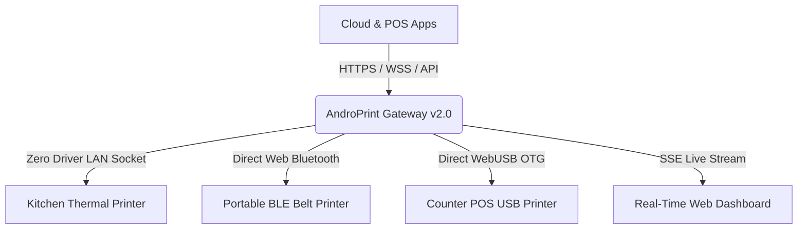

<div align="center">

# 🖨️ ANDROPRINT v2.0
### *Next-Gen Cloud & LAN Thermal ESC/POS Print Gateway*

<p align="center">
  
</p>

[](https://github.com/msamods/androprint)
[](https://github.com/msamods/androprint)
[](https://github.com/msamods/androprint)
[](LICENSE)

[-3DDC84?style=for-the-badge&logo=android&logoColor=white)](https://github.com/msamods/androprint/releases/download/v2.0.0/AndroPrint-v2.0.0-release.apk)
[-0078D6?style=for-the-badge&logo=windows&logoColor=white)](https://github.com/msamods/androprint/releases/download/v2.0.0/AndroPrint-Windows.exe)
[](https://github.com/msamods/androprint/releases/tag/v2.0.0)

<br/>

> **Developed By : [MSA MODS](https://github.com/msamods) × WhatYouWantKerala**  
> *Transform any Android Phone, Windows Desktop, or Raspberry Pi into a high-speed, secure Cloud Thermal Print Server with zero drivers.*

<br/>

[✨ Features](#-key-features) • [🌐 Web Direct Print](#-web-direct-printing) • [📱 Native APK](#-native-android-print-agent-apk) • [🪟 Windows Exe](#-windows-standalone-exe) • [🔒 Localhost SSL](#-localhost-https--ssl-support) • [🔌 API Docs](#-rest-api-documentation)

---

</div>

<br/>

## 🌟 Highlights at a Glance

<table>
  <tr>
    <td width="50%" align="center">
      
      <h3>📱 Mobile-First Architecture</h3>
      <p>Runs on any cheap Android device with background Wakelock. No PCs, Raspberry Pis, or dedicated spoolers required.</p>
    </td>
    <td width="50%" align="center">
      
      <h3>☁️ Cloud Connected Relay</h3>
      <p>Print from remote Web Apps, Shopify, WooCommerce, or AWS directly to physical kitchen/cashier printers worldwide.</p>
    </td>
  </tr>
  <tr>
    <td width="50%" align="center">
      <h3>📶 Web Bluetooth & USB</h3>
      <p>Connect and print directly inside Chromium web browsers using Web Bluetooth (BLE) or WebUSB OTG cables.</p>
    </td>
    <td width="50%" align="center">
      <h3>🌐 Any-Language UTF-8</h3>
      <p>Full support for Malayalam (മലയാളം), Hindi, Tamil, Arabic, Chinese, Cyrillic, and European scripts.</p>
    </td>
  </tr>
</table>

<br/>

---

## ⚡ Key Features



- 🚀 **Zero-Driver ESC/POS Engine**: Communicates over RAW TCP socket (Port 9100) directly to thermal receipt printers.
- 🎨 **Futuristic Glassmorphic Web Dashboard**: Dark-mode operations terminal with live telemetry, stat counters, and quick-actions.
- 📡 **Real-Time SSE Streaming**: Server-Sent Events (`/api/events`) push real-time printer status, job results, and tunnel events.
- 📶 **Web Bluetooth (BLE) & WebUSB Direct Print**: Pair & print straight from web browser tabs with zero desktop spoolers.
- 🌍 **Cloudflare Tunnel Auto-Manager**: Instant public HTTPS tunnel without static IP addresses or complex router port forwarding.
- 🔒 **Enterprise-Grade Client Auth**: Generate client credentials with instant copy headers (`x-client-id`, `x-print-key`).
- 📜 **Audited Print Job Queue**: Complete print history logged and persisted to `jobs.json` with retry capability.
- 🛡️ **Localhost HTTPS / WSS**: Built-in SSL cert auto-detection solving browser mixed-content restrictions on local agents.

<br/>

---

## 🏗️ Interactive Web Dashboard

| Interface | Description | Live Route |
| :--- | :--- | :--- |
| **🖨️ Operations Terminal** | Telemetry, device health, quick print, and live printer cards | [`dashboard.html`](public/dashboard.html) |
| **📶 Web Direct Print** | Browser-to-Printer Bluetooth & USB OTG direct controller | [`webprint.html`](public/webprint.html) |
| **⚙️ Hardware Config** | Network printer management, test print dispatch, paper sizes | [`printer.html`](public/printer.html) |
| **👥 POS Clients** | API keys, secret tokens, granular client permission toggles | [`clients.html`](public/clients.html) |
| **☁️ Cloud Connect** | Cloudflare & Ngrok tunnel registration and cURL generators | [`cloud.html`](public/cloud.html) |
| **📋 Queue Telemetry** | Historical logs, success/failure analytics, and job inspector | [`jobs.html`](public/jobs.html) |

<br/>

---

## 🚀 Quick Start Guide

### 1️⃣ Option A: Android (Termux)
```bash
# Clone and setup (Installs packages, acquires Wakelock, and sets up Termux:Boot)
git clone https://github.com/msamods/androprint.git
cd androprint
bash setup.sh

# Run Server manually
node server.js
```
> 💡 **Auto-Start on Phone Boot**: `setup.sh` automatically configures `~/.termux/boot/start-androprint.sh`. Whenever you restart your Android phone, AndroPrint will boot up in the background automatically with Wakelock enabled!


### 2️⃣ Option B: Linux / Windows / macOS (Node.js)
```bash
git clone https://github.com/msamods/androprint.git
cd androprint
npm install
npm start
```

### 3️⃣ Option C: Windows Standalone (`.exe`)
No Node.js or npm needed on client PCs! Build or run the standalone Windows binary:
```bash
npm run build:exe
```
Generates `dist/androprint-windows.exe`. Double-click to launch the print agent as a background Windows service.

---

## 📱 Native Android Print Agent (APK)

A complete native Android application project with **Background Foreground Service** and **WakeLock** is available in [`android-app/`](android-app/):

- **One-Touch Start / Stop**: Toggle the print engine with a single button.
- **Doze Mode Immunity**: Runs 24/7 without being stopped by Android battery managers.
- **Auto Wi-Fi IP Detection**: Instantly shows your phone's LAN IP address on the screen.
- **Build APK**: Open `androprint/android-app` in Android Studio and click **Build > Build APK(s)**.

<br/>

---

## 🔒 Localhost HTTPS & SSL Configuration

When your web app is hosted on an HTTPS domain (e.g. `https://pos.myrestaurant.com`), modern browsers block calls to insecure `http://localhost:3000` (Mixed Content).

AndroPrint includes native SSL support:

```bash
# Generate trusted localhost certificates
npm run ssl
# OR using mkcert
mkcert -key-file server.key -cert-file server.cert localhost 127.0.0.1 ::1

# Start server with SSL enabled
USE_SSL=true node server.js
```
The server will now automatically bind to **`https://localhost:3000`** with zero mixed-content warnings!

<br/>

---

## 🌐 Any-Language Multilingual Receipts

AndroPrint supports raw UTF-8 multi-byte encoding for printing receipts in any international or regional script:

<details>
<summary><b>Click to view Malayalam (മലയാളം) Receipt Payload</b></summary>

```json
{
  "printerId": "Cashier1",
  "text": "*** ആന്ത്രോപ്രിന്റ് ക്ലൗഡ് ***\nമേശ നമ്പർ: 04    തീയതി: 2026-10-20\n--------------------------------\n1x ചിക്കൻ ബിരിയാണി        ₹180.00\n1x മലബാർ പൊറോട്ട (3 എണ്ണം)  ₹45.00\n1x ഫ്രഷ് ലൈം സോഡ          ₹40.00\n--------------------------------\nആകെ തുക:                   ₹265.00\n--------------------------------\n       നന്ദി! വീണ്ടും വരിക!\n"
}
```
</details>

<details>
<summary><b>Click to view Hindi (हिन्दी) Receipt Payload</b></summary>

```json
{
  "printerId": "Cashier1",
  "text": "*** एंड्रोप्रिंट क्लाउड ***\nमेज संख्या: 04    दिनांक: 2026-10-20\n--------------------------------\n1x पनीर टिक्का मसाला      ₹220.00\n2x तंदूरी रोटी              ₹40.00\n1x मीठी लस्सी               ₹50.00\n--------------------------------\nकुल योग:                  ₹310.00\n--------------------------------\n    धन्यवाद! फिर पधारें!\n"
}
```
</details>

<details>
<summary><b>Click to view Arabic (العربية) Receipt Payload</b></summary>

```json
{
  "printerId": "Cashier1",
  "text": "*** أندروبرينت كلاود ***\nطاولة رقم: ٠٤\n--------------------------------\n١x شاورما دجاج             ٣٥.٠٠ ر.س\n١x بطاطس مقلية            ١٥.٠٠ ر.س\n--------------------------------\nالمجموع الكلي:            ٥٠.٠٠ ر.س\n--------------------------------\n        شكراً لزيارتكم!\n"
}
```
</details>

<br/>

---

## 🔌 REST API Documentation

> 📖 **Full Interactive API Wiki & Payload Schema**: [**Read the Complete API Reference Wiki →**](wiki/API-Reference.md)  
> 🏠 **Wiki Home**: [**AndroPrint Documentation Wiki →**](wiki/Home.md)

### Authentication Headers
For secure endpoints, pass your client credentials:
```http
x-client-id: clt-admin
x-print-key: 123456
```

### Endpoints Table

| Method | Endpoint | Description | Auth Required |
|:--- |:--- |:--- |:---:|
| `POST` | `/print` | Dispatch standard ESC/POS ticket | **Yes** |
| `POST` | `/api/quickprint` | Send fast raw text directly to printer | No |
| `GET` | `/api/printers` | List all configured printers & TCP online state | **Yes** |
| `POST` | `/api/printer/save` | Add or update printer configuration | **Yes** |
| `POST` | `/api/printer/test` | Dispatch diagnostic hardware test ticket | **Yes** |
| `POST` | `/api/printer/delete` | Remove printer by ID | **Yes** |
| `GET` | `/api/jobs` | Retrieve print job queue history | No |
| `POST` | `/api/jobs/clear` | Clear print job history | No |
| `GET` | `/api/events` | Server-Sent Events (SSE) live push stream | No |
| `GET` | `/api/clients` | List all POS API clients | No |
| `POST` | `/api/client/create` | Generate new API client & key | No |
| `POST` | `/api/client/toggle` | Enable or disable client access | No |
| `POST` | `/api/client/delete` | Delete an API client | No |
| `GET` | `/api/cloud` | Query active Cloudflare tunnel status | No |
| `POST` | `/api/cloud/register` | Register active cloud tunnel URL | No |
| `POST` | `/api/cloud/disconnect`| Disconnect cloud tunnel | No |

<br/>

---

## 💻 Integration Code Snippets

<details>
<summary><b>Kotlin (Android App)</b></summary>

```kotlin
val client = OkHttpClient()
val json = JSONObject().apply {
    put("printerId", "Cashier1")
    put("text", "Receipt Text Here\n")
}
val body = json.toString().toRequestBody("application/json".toMediaType())
val request = Request.Builder()
    .url("https://print.yourdomain.com/print")
    .addHeader("x-client-id", "clt-admin")
    .addHeader("x-print-key", "123456")
    .post(body)
    .build()

client.newCall(request).enqueue(callback)
```
</details>

<details>
<summary><b>C# / .NET (Windows Desktop .exe)</b></summary>

```csharp
using var client = new HttpClient();
var payload = new { printerId = "Cashier1", text = "Invoice #1024\n" };
var request = new HttpRequestMessage(HttpMethod.Post, "https://localhost:3000/print") {
    Content = new StringContent(JsonSerializer.Serialize(payload), Encoding.UTF8, "application/json")
};
request.Headers.Add("x-client-id", "clt-admin");
request.Headers.Add("x-print-key", "123456");
await client.SendAsync(request);
```
</details>

<details>
<summary><b>Python (Backend / Microservice)</b></summary>

```python
import requests

requests.post(
    "https://your-tunnel.trycloudflare.com/print",
    headers={"x-client-id": "clt-admin", "x-print-key": "123456"},
    json={"printerId": "Cashier1", "text": "Order #42\nTotal: Rs. 250\n"}
)
```
</details>

<br/>

---

<div align="center">

## 📄 License & Credits

Developed with ❤️ By **[MSA MODS](https://github.com/msamods)** × **WhatYouWantKerala**

Released under the **[MIT License](LICENSE)**.

<p align="center">
  
</p>

</div>
