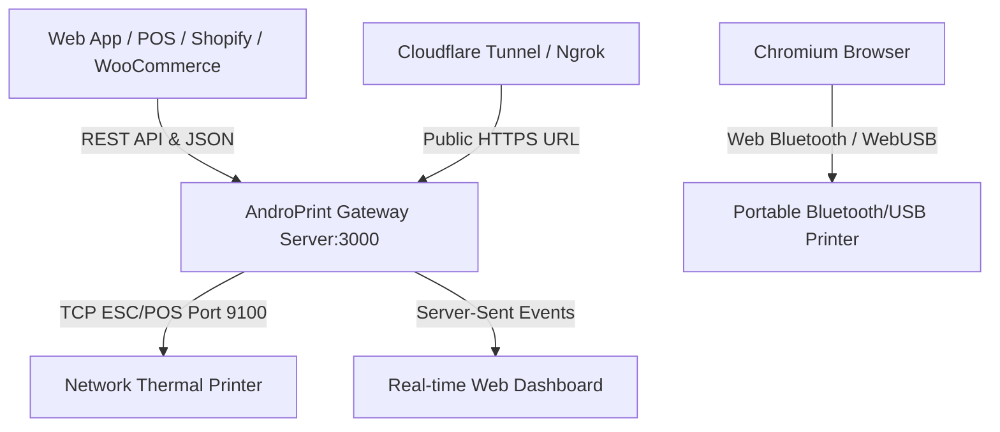

# 🖨️ AndroPrint Wiki

Welcome to the **AndroPrint v2.0** official technical documentation and wiki.

> **Developed By : [MSA MODS](https://github.com/msamods) × WhatYouWantKerala**  
> *Transform any Android Phone, Windows Desktop, or Raspberry Pi into a high-speed, secure Cloud Thermal Print Server with zero drivers.*

---

## 📚 Wiki Directory

### 🔌 API Documentation
- [**API Reference**](API-Reference) — Complete REST API reference for all endpoints (`/print`, `/api/print/route`, `/api/print/html`, `/api/print/pdf`, `/api/printers/discover`)
- [**Developer Client SDK**](Developer-SDK-Guide) — Official JavaScript, Node.js, Python, Flutter, and PHP integration library with Pair Code support
- [**Webhook Printing Engine**](Webhook-Integration) — Automated receipt printing from WooCommerce, Shopify, Telegram bots & Custom Webhooks
- [**Authentication & Security**](Authentication) — API Client Keys, Header signatures (`x-client-id`, `x-print-key`), and `ENABLE_AUTH` mode
- [**Real-time Streaming (SSE)**](WebSocket-and-SSE) — Live Server-Sent Events stream (`/api/events`) for monitoring logs, jobs, and printer status
- [**MQTT Cloud Pub/Sub**](API-Reference#-mqtt-cloud-pubsub-instant-printing) — Zero-tunnel, sub-100ms global printing without open ports

### 🖨️ Hardware & Integration
- [**Receipt Template Designer**](Printing-Guide) — Visual WYSIWYG drag-and-drop receipt builder with live 58mm/80mm preview
- [**Multi-Printer Smart Routing**](API-Reference#-smart-multi-printer-routing-api) — Role-based KOT, BOT, and Bill routing with automatic failover
- [**Auto Network Discovery**](API-Reference#-network-printer-auto-discovery-api) — Subnet radar scanning Port 9100 with ESC/POS model query
- [**ESC/POS Printing Guide**](Printing-Guide) — Network (TCP/IP) thermal printers, UTF-8 multilingual printing (Malayalam, Arabic, Hindi, etc.), paper widths (58mm/80mm), and cut commands
- [**Web Bluetooth & WebUSB**](Web-Bluetooth-and-USB) — Browser-based direct printing via BLE and USB OTG without installing any drivers

### 📦 Platforms & Deployment
- [**Android Native Agent**](Android-Native-Agent) — Background Foreground Service, Wakelock, APK build, and Termux:Boot configuration
- [**Windows Standalone Agent**](Windows-Standalone-Agent) — Portable 64-bit EXE deployment without Node.js

---

## ⚡ Quick Architecture Overview

---
*Developed By : MSA MODS x WhatYouWantKerala*
